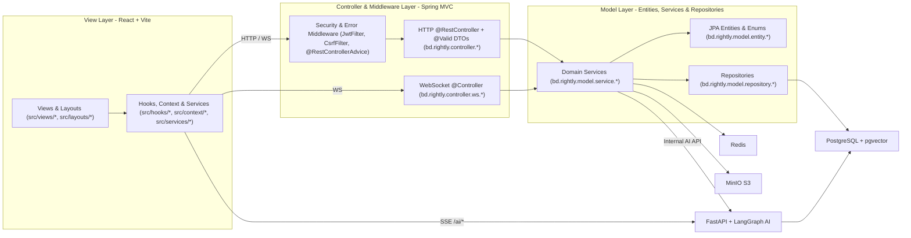
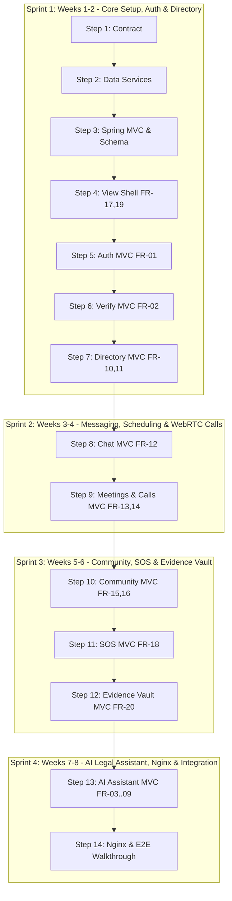

# Rightly Sprint-by-Sprint Build Plan (MVC Architecture)

Local academic MVP built strictly around **Model–View–Controller (MVC)** and organized into the **4 Agile Sprints (Weeks 1–8)** defined in Section 5 of the Rightly SRS. Finish each step and run its pass check before starting the next, and verify each Sprint's end-to-end milestone before moving to the next Sprint.

Substitutes for services that need paid accounts:

- MinIO for S3
- Mailpit for email, server log for SMS
- A local file-present check for NID and selfie matching
- A short checked-in law excerpt file for retrieval
- A cloud LLM only inside the AI step

---

## MVC Architecture & Layer Rules

Every feature in Rightly is split cleanly across **Model**, **View**, and **Controller** with strict separation of concerns (DRY, SOLID, small single-responsibility units, no god classes, no duplicated logic):

1. **Model (`backend-java/src/main/java/bd/rightly/model/`)**:
   - Owns all application state, domain rules, data relationships, and persistence.
   - `bd.rightly.model.entity`: JPA `@Entity` classes (`User`, `ProfessionalProfile`, `AvailabilitySlot`, `Thread`, `Message`, `Meeting`, `CommunityAlias`, `CommunityPost`, `Comment`, `ContentReport`, `TrustedContact`, `SosAlert`, `EvidenceItem`, `LegalDocument`, `AiConversation`, `AiMessage`) and enums (`Role`, `VerificationStatus`, `MeetingStatus`), including rich domain methods (`User.isVerified()`, `ProfessionalProfile.updateDetails(...)`, `AvailabilitySlot.markBooked()`, `Thread.addMessage(...)`, `Meeting.accept()`/`decline()`, `CommunityPost.hide()`, `SosAlert.buildMapLink()`).
   - `bd.rightly.model.repository`: Spring Data JPA repositories (parameterized queries only; no SQL injection) and Redis/MinIO data adapters.
   - `bd.rightly.model.service`: Business workflows, validation rules, authorization invariants, OTP hashing, moderation rules, and external gateway interfaces/implementations (`IdentityVerifier` / `LocalIdentityVerifier`, `NotificationGateway` / `LocalNotificationGateway`).
   - **Rule**: Models never depend on HTTP `HttpServletRequest`, WebSocket sessions, or UI formatting.

2. **Controller, Validators & Middleware (`backend-java/src/main/java/bd/rightly/controller/`, `middleware/`, `config/`)**:
   - `bd.rightly.controller` & `bd.rightly.controller.ws`: Lightweight HTTP `@RestController` and WebSocket `@Controller` endpoints that map routes, delegate to Model services, and return consistent response DTOs.
   - `bd.rightly.controller.dto`: Request/response DTOs with Bean Validation (`@Valid`, `@NotBlank`, etc.) and custom validators.
   - `bd.rightly.middleware` & `bd.rightly.config`: JWT/CSRF/Role/Verification filters, centralized `@RestControllerAdvice` error handling (consistent HTTP status codes and error envelope; never leak stack traces or DB internals), and Spring Security / Redis / MinIO / WebSocket / OpenAPI configuration.
   - `bd.rightly.util` & `bd.rightly.constant`: Shared helpers and constants (e.g., `rightly:` Redis key prefixes, `Asia/Dhaka` zone ID).
   - **Rule**: Controllers stay thin and contain zero SQL/JPA queries and zero business workflow logic.

3. **View (`frontend/src/`)**:
   - React + Vite + TypeScript + Tailwind CSS structured cleanly into `views/`, `components/`, `layouts/`, `routes/`, `services/` (Axios/WS/SSE transport wrappers), `hooks/`, `context/`, `types/`, `utils/`, and `styles/`.
   - Responsible solely for rendering state, capturing user input, handling browser-only APIs (Camera, Microphone, Geolocation, WebRTC peer media, Web Crypto AES-GCM), and calling Controllers.
   - **Rule**: Business rules, role authorization, moderation thresholds, and database/persistence logic never live in Views.

4. **AI Service (`backend-ai/`)**:
   - Modular Python FastAPI structure (`app/config.py`, `app/routes/`, `app/services/`, `app/models/`, `app/middleware/`, `app/utils/`) with centralized exception handlers, Pydantic request/response schemas, JWT cookie verification, and no single-file monoliths.

---

## Architecture Protection, Workflow & Verification Rules

- **Pre-Feature Workflow**: Before implementing any step/feature: (1) inspect existing structure, (2) identify exact `model`/`service`/`controller`/`route`/`view` files affected, (3) reuse existing components/services, (4) implement without bypassing MVC, (5) add/update unit & API tests, and (6) verify imports, dependencies, and routes.
- **Protection Rules**: Never create random root files, never introduce alternative folder structures, never hardcode secrets, and never bypass MVC for convenience.
- **Per-Step & Per-Sprint Verification Gate**: After completing each step/feature, verify MVC boundaries remain intact, check for duplicated code or unused files/imports, run tests (`mvn test`, `pytest`, `npm run lint && npm run build`), check for security issues, and report created/modified/deleted files.

---

## Locked Decisions

- One origin in the final stack: `http://localhost:8080`. During earlier steps, Spring Boot is `8081` and Vite is `5173`.
- Java MVC package tree under `bd.rightly`:
  - `bd.rightly.model.entity`
  - `bd.rightly.model.repository`
  - `bd.rightly.model.service`
  - `bd.rightly.controller` (and `bd.rightly.controller.dto`, `bd.rightly.controller.ws`)
  - `bd.rightly.middleware` (JWT, CSRF, role/verification guards, `@RestControllerAdvice` centralized error handler)
  - `bd.rightly.config` (Spring Security, Redis, MinIO, WebSocket, OpenAPI)
  - `bd.rightly.util`, `bd.rightly.constant`
- Frontend View tree under `frontend/src`:
  - `src/views/` (`HomeView`, `AuthView`, `VerifyView`, `AssistantView`, `DirectoryView`, `ProfileEditView`, `ChatView`, `CallView`, `CommunityView`, `SosView`, `EvidenceVaultView`, `EmergencyView`)
  - `src/layouts/SafetyLayout.tsx`
  - `src/components/`, `src/routes/`, `src/services/` (API/WS/SSE clients), `src/hooks/`, `src/context/`, `src/types/`, `src/utils/`, `src/styles/`
- Session cookie: `RIGHTLY_SESSION`. `HttpOnly`, `SameSite=Lax`, `Path=/`. `Secure` stays off on local HTTP.
- CSRF: a non-HttpOnly `RIGHTLY_CSRF` cookie. Axios sends it back as `X-CSRF-Token` on every mutating request.
- JWT claims: `sub` (user id), `role`, `exp` (2 hours). No personal data in the token.
- Roles: `USER`, `LAWYER`, `PSYCHIATRIST`.
- Verification: every role must reach `VERIFIED` before messaging, community, SOS, or the vault. Login and profile editing work before that.
- Time is stored in UTC. Slot walls are `Asia/Dhaka`.
- Redis keys use the prefix `rightly:` and a TTL. OTP keys expire in 5 minutes. No `KEYS` command.
- Evidence plaintext and the AES key never reach the server.
- Embeddings are 1536 dimensions, matching `text-embedding-3-small`.

---

## Sprint Roadmap (Weeks 1–8)

Each feature step builds the **Model**, **Controller**, and **View** for one vertical slice and verifies them together.

| Sprint | Weeks | Scope | Functional Requirements |
| :--- | :--- | :--- | :--- |
| **Sprint 1** | Weeks 1–2 | Core Setup, Auth & Directory | FR-01, FR-02, FR-10, FR-11, FR-17, FR-19 |
| **Sprint 2** | Weeks 3–4 | Messaging, Scheduling & WebRTC Calls | FR-12, FR-13, FR-14 |
| **Sprint 3** | Weeks 5–6 | Community, SOS & Evidence Vault | FR-15, FR-16, FR-18, FR-20 |
| **Sprint 4** | Weeks 7–8 | AI Legal Assistant, Nginx & Integration | FR-03 to FR-09, Full E2E |

---

## Sprint 1 (Weeks 1–2): Core Setup, Auth & Directory

**Sprint 1 Goal:** Set up the repository, Docker Compose data services, Flyway schema, React shell with emergency footer and Quick Exit (FR-17, FR-19), OTP registration/login with JWT cookies (FR-01), NID/selfie verification (FR-02), and professional profile management with filtered directory search (FR-10, FR-11).

### Step 1 — Contract

Create the foundational documentation and environment files later steps read:

- `README.md`: Project setup, installation, execution, deployment, sprint/step list, and local URLs
- `ARCHITECTURE.md`: Folder structure, MVC layer rules, architectural decisions, and module responsibilities
- `.env.example`: `POSTGRES_DB`, `POSTGRES_USER`, `POSTGRES_PASSWORD`, `REDIS_URL`, `MINIO_ENDPOINT`, `MINIO_ACCESS_KEY`, `MINIO_SECRET_KEY`, `MINIO_BUCKET=rightly-evidence`, `MAIL_HOST`, `MAIL_PORT`, `JWT_SECRET`, `LLM_API_KEY`, `LLM_BASE_URL`, `LLM_CHAT_MODEL`, `LLM_EMBED_MODEL` (placeholders only, no real secrets)
- `.gitignore` for Maven, Python, Node, `.env`, and upload leftovers
- Empty `frontend/`, `backend-java/`, `backend-ai/`, `nginx/`

**Pass check:** `.env.example` contains placeholders only, `README.md` covers setup/execution, and `ARCHITECTURE.md` documents the Model, View, Controller, Service, Repository, and Middleware boundaries.

### Step 2 — Data services

`docker-compose.yml` runs only `postgres` (`pgvector/pgvector:pg16`), `redis`, `minio`, and `mailpit`, with volumes and healthchecks.

- Postgres `5432`, Redis `6379`, MinIO `9000` and console `9001`, Mailpit UI `8025` and SMTP `1025`
- Create bucket `rightly-evidence` on startup

**Pass check:** `docker compose up -d` is healthy, Mailpit opens, and `CREATE EXTENSION IF NOT EXISTS vector;` succeeds.

### Step 3 — Spring Boot MVC foundation and schema

Create `backend-java` (Java 21, Spring Boot 3, Spring MVC Web, Security, Validation, Data JPA, Flyway, Redis, springdoc) organized into `model` (`entity`, `repository`, `service`), `controller` (`dto`, `ws`), `middleware`, `config`, `util`, and `constant` packages. Configure centralized `@RestControllerAdvice` exception handling (consistent error DTO, no stack traces exposed in production) and security permitting only `/api/health` and Swagger (`/swagger-ui.html`) until Step 5.

Flyway files in `backend-java/src/main/resources/db/migration/`:

- `V1__init_core.sql`: `users` (`role`: `USER`/`LAWYER`/`PSYCHIATRIST`; `verification_status`: `UNVERIFIED`/`PENDING`/`VERIFIED`/`REJECTED`) — OTPs are stored in Redis with TTL, matching `Class_diagram.png`
- `V2__directory_and_messaging.sql`: `professional_profiles`, `availability_slots`, `threads`, `messages`, `meetings` (`status`: `REQUESTED`/`ACCEPTED`/`DECLINED`, `room_code`, `reminder_sent`)
- `V3__community_and_safety.sql`: `community_aliases`, `community_posts`, `comments` (`community_comments`), `content_reports`, `trusted_contacts`, `sos_alerts`, `evidence_items`
- `V4__ai.sql`: `legal_documents` (`act_name`, `section_number`, `source_url`, `content`, `embedding vector(1536)`), `ai_conversations` (`distress_flagged`), `ai_messages` (`sender_type`, `content`, `citations_json`)

- **Model**: `HealthService` checks Postgres and Redis connectivity.
- **Controller**: `HealthController` exposes `GET /api/health`. Add a Dockerfile.

**Pass check:** `mvn test` passes, the app listens on `8081`, Flyway applies V1–V4, and `/api/health` reports both dependencies up.

### Step 4 — View shell (FR-17, FR-19)

Create `frontend` with Vite, React, TypeScript, Tailwind, React Router, Axios, and `vite-plugin-pwa`.

- Axios `baseURL` is `/api` in the final stack and `http://localhost:8081/api` before Nginx, with `withCredentials: true`
- `src/layouts/SafetyLayout.tsx` wraps every View except the neutral exit target
- Footer links: `tel:999` and `tel:109`
- Quick Exit button, and Esc three times within 2 seconds, calls `location.replace("https://www.wikipedia.org")` after a one-line history reminder
- `src/views/EmergencyView.tsx` (`/emergency`) is precached and renders the hotlines plus a short offline note
- Placeholder View components under `src/views/` for `/`, `/login`, `/verify`, `/assistant`, `/directory`, `/threads/:id`, `/call/:meetingId`, `/community`, `/sos`, `/vault`

**Pass check:** `npm run build` and `npm run lint` (ESLint + `tsc --noEmit`) succeed, the footer is on `/`, Quick Exit leaves the origin, and the built service worker precaches `/emergency`.

### Step 5 — Auth MVC slice (FR-01)

- **Model**:
  - `entity/User.java` (`id`, `fullName`, `email`, `phone`, `role`, `verificationStatus`, `createdAt`, `isVerified()`), `entity/Role.java`, `entity/VerificationStatus.java`, `repository/UserRepository.java`
  - `service/AuthService.java`: 6-digit OTP generation, hashed in Redis at `rightly:otp:{userId}` (5-min TTL) with send rate limit at `rightly:otp-send:{userId}`
  - `service/NotificationGateway.java` (`sendEmail`, `sendSms`) & `service/LocalNotificationGateway.java`: Mailpit email + console `SMS to {phone}: {code}`
- **Controller**:
  - `controller/AuthController.java`: `POST /api/auth/register` (`role`, `fullName`, and one of `email` or `phone`), `POST /api/auth/otp/request`, `POST /api/auth/otp/verify` (sets `RIGHTLY_SESSION` + `RIGHTLY_CSRF` cookies), `POST /api/auth/logout` (clears cookies), `GET /api/auth/me`
  - Mutating routes require matching `X-CSRF-Token`
- **View**:
  - `src/views/AuthView.tsx`: registration form, OTP request/verify inputs, and current user session display from `/api/auth/me`

**Pass check:** the code appears in Mailpit or the log, reload keeps the session, a mutating request without `X-CSRF-Token` is rejected, and logout returns 401 for `/api/auth/me`.

### Step 6 — Verification MVC slice (FR-02)

- **Model**:
  - `service/VerificationService.java`, `service/IdentityVerifier.java` (`verify(userId, nidKey, selfieKey) : VerificationStatus`), & `service/LocalIdentityVerifier.java`: stores NID and selfie objects in MinIO under `verification/{userId}/`, approves when both objects exist and selfie MIME type is an image, transitions `User.verificationStatus` from `UNVERIFIED` -> `PENDING` -> `VERIFIED` or `REJECTED`
- **Controller**:
  - `controller/VerificationController.java`: `POST /api/verification/nid` and `POST /api/verification/selfie`
- **View**:
  - `src/views/VerifyView.tsx`: NID upload + browser camera selfie capture (`getUserMedia`) with file-input fallback

**Pass check:** both uploads appear in MinIO and `/api/auth/me` shows `VERIFIED`.

### Step 7 — Directory & Profiles MVC slice (FR-10, FR-11)

- **Model**:
  - `entity/ProfessionalProfile.java` (`id`, `displayName`, `district`, `specialty`, `feeBdt`, `languages`, `bio`, `updateDetails(...)`), `repository/ProfessionalProfileRepository.java`
  - `service/DirectoryService.java` & `service/ProfileService.java`: profile upsert, filtered search, 60-second Redis cache on unfiltered page 0 (`rightly:directory:default`), seed runner creating 1 Dhaka family lawyer, 1 Chattogram criminal lawyer, and 1 Dhaka psychiatrist
- **Controller**:
  - `controller/ProfileController.java`: `PUT /api/profiles/me` (`displayName`, `district`, `specialty`, `feeBdt`, `languages`, `bio`)
  - `controller/DirectoryController.java`: `GET /api/directory` (`role`, `district`, `specialty`, `maxFee`, `language`, `page`, `size`)
- **View**:
  - `src/views/DirectoryView.tsx` (search filters + result cards) and `src/views/ProfileEditView.tsx` (shown to signed-in lawyers/psychiatrists)

**Pass check:** filtering by district and specialty returns the matching seed, and a user cannot edit another profile.

---

## Sprint 2 (Weeks 3–4): Messaging, Scheduling & WebRTC Calls

**Sprint 2 Goal:** Implement private 1:1 threads, live WebSocket chat, Redis presence, and offline notifications (FR-12), plus Bangladesh-time (`Asia/Dhaka`) availability slots, booking requests, accept/decline workflow, reminders, and WebRTC signaling for browser video/audio calls (FR-13, FR-14).

### Step 8 — Messaging MVC slice (FR-12)

- **Model**:
  - `entity/Thread.java` (`id`, `createdAt`, `addMessage(sender, body)`), `entity/Message.java` (`id`, `body`, `sentAt`), `repository/ThreadRepository.java`, `repository/MessageRepository.java`
  - `service/MessagingService.java`: pair-thread creation, `Thread.addMessage(...)` persistence, Redis presence (`rightly:presence:{userId}`, 60s TTL), offline fallback via `NotificationGateway` (`LocalNotificationGateway` Mailpit/SMS log; Web Push stub interface)
- **Controller**:
  - `controller/MessageController.java`: `POST /api/threads`, `GET /api/threads`, `GET /api/threads/{id}/messages`, `POST /api/threads/{id}/messages`
  - `controller/ws/ChatWebSocketController.java`: `/ws/chat` real-time message delivery and presence heartbeat
- **View**:
  - `src/views/ChatView.tsx`: thread list and real-time message view appending incoming WebSocket messages without reload

**Pass check:** two verified browsers exchange a message, and a closed recipient tab produces one offline notice.

### Step 9 — Meetings & Calls MVC slice (FR-13, FR-14)

- **Model**:
  - `entity/AvailabilitySlot.java` (`id`, `startTimeUtc`, `endTimeUtc`, `booked`, `markBooked()`), `entity/Meeting.java` (`id`, `status` via `MeetingStatus`, `roomCode`, `reminderSent`, `createdAt`, `accept()`, `decline()`), `entity/MeetingStatus.java`, `repository/AvailabilitySlotRepository.java`, `repository/MeetingRepository.java`
  - `service/SchedulingService.java`: `Asia/Dhaka` slot replacement, overlap/double-booking prevention using `AvailabilitySlot.markBooked()`, meeting `accept()`/`decline()` orchestration with `roomCode` generation, and 30-minute reminder scheduler (`reminderSent`) via `NotificationGateway`
- **Controller**:
  - `controller/AvailabilityController.java` (`PUT /api/availability`, `GET /api/availability/{professionalId}`)
  - `controller/MeetingController.java` (`POST /api/meetings`, `POST /api/meetings/{id}/accept`, `POST /api/meetings/{id}/decline`)
  - `controller/ws/CallSignalingController.java` (`/ws/call` relaying `offer`, `answer`, `ice-candidate` without touching media)
- **View**:
  - `src/views/ChatView.tsx` (slot picker + confirmed meeting banner), `src/views/ProfileEditView.tsx` (Dhaka slot editor), and `src/views/CallView.tsx` (WebRTC video/audio call room with audio-only toggle)

**Pass check:** a slot can be requested and accepted, and two browsers complete signaling for that meeting.

---

## Sprint 3 (Weeks 5–6): Community, SOS & Evidence Vault

**Sprint 3 Goal:** Implement anonymous alias community posts, threaded comments, reporting, and keyword/threshold auto-hide (FR-15, FR-16), trusted contacts and one-tap SOS alerts with map link or typed address fallback (FR-18), and browser-side AES-GCM evidence encryption with chunked resumable MinIO uploads (FR-20).

### Step 10 — Community MVC slice (FR-15, FR-16)

- **Model**:
  - `entity/CommunityAlias.java` (`id`, `aliasName`), `entity/CommunityPost.java` (`id`, `title`, `body`, `hidden`, `createdAt`, `hide()`), `entity/Comment.java` (`id`, `body`, `createdAt`), `entity/ContentReport.java` (`id`, `reason`, `createdAt`) + repositories
  - `service/CommunityService.java`: deterministic alias generation on first post, checked-in keyword auto-hide filter, and report counter calling `CommunityPost.hide()` (`hidden=true`) at 3 reports
- **Controller**:
  - `controller/CommunityController.java`: `GET /api/community/posts`, `POST /api/community/posts`, `POST /api/community/posts/{id}/comments`, `POST /api/community/posts/{id}/report`
- **View**:
  - `src/views/CommunityView.tsx`: anonymous feed, threaded comments, and report action

**Pass check:** user B sees user A's alias only, and the third report removes the post from B's list.

### Step 11 — SOS MVC slice (FR-18)

- **Model**:
  - `entity/TrustedContact.java` (`id`, `name`, `phone`), `entity/SosAlert.java` (`id`, `latitude`, `longitude`, `typedAddress`, `sentAt`, `buildMapLink()`) + repositories
  - `service/SosService.java`: records `SosAlert`, builds Google Maps link via `SosAlert.buildMapLink()` (or uses `typedAddress`), and dispatches SMS alerts to all saved contacts via `NotificationGateway.sendSms(...)`
- **Controller**:
  - `controller/SosController.java`: `GET/POST/DELETE /api/safety/contacts`, `POST /api/safety/sos`
- **View**:
  - `src/views/SosView.tsx`: trusted contacts form, one-tap SOS button requesting `navigator.geolocation` with typed-address fallback, and prominent `tel:999` link

**Pass check:** one `sos_alerts` row exists and the contact message contains the map link or typed address.

### Step 12 — Evidence Vault MVC slice (FR-20)

- **Model**:
  - `entity/EvidenceItem.java` (`id`, `fileName`, `objectKey`, `sizeBytes`, `sha256`, `clientTimestamp`), `repository/EvidenceItemRepository.java`
  - `service/EvidenceService.java`: generates MinIO presigned multipart upload URLs for ciphertext and records `fileName`, `objectKey`, `sizeBytes`, `sha256`, and `clientTimestamp` on completion
- **Controller**:
  - `controller/EvidenceController.java`: `POST /api/evidence/uploads`, `POST /api/evidence/uploads/{id}/complete`, `GET /api/evidence`
- **View**:
  - `src/views/EvidenceVaultView.tsx`: browser audio `MediaRecorder` + file picker, client-side AES-GCM encryption (`crypto.subtle`, key kept in `sessionStorage`), chunked resumable upload to presigned URLs, and evidence list

**Pass check:** the stored MinIO object is ciphertext (not original plaintext), and the owner sees the completed row.

---

## Sprint 4 (Weeks 7–8): AI Legal Assistant, Nginx & Integration

**Sprint 4 Goal:** Seed Bangladesh legal excerpts into `pgvector`, add the PyTorch distress classifier, and build the LangGraph SSE streaming assistant (FR-03 to FR-09); configure Nginx single-origin routing on port `8080`, run automated tests, and verify all 20 requirements end-to-end.

### Step 13 — AI Legal Assistant MVC slice (FR-03 to FR-09)

Add `backend-ai` to Compose and wire the MVC conversation history + AI stream.

- **Model**:
  - `entity/LegalDocument.java` (`id`, `actName`, `sectionNumber`, `sourceUrl`, `content`, `embedding float[1536]`), `entity/AiConversation.java` (`id`, `distressFlagged`, `createdAt`), `entity/AiMessage.java` (`id`, `senderType`, `content`, `citationsJson`, `createdAt`) + repositories
  - `service/LegalAssistantService.java`: manages user conversation list/history and lawyer/psychiatrist recommendation lookups
  - `backend-ai/` (modular FastAPI structure: `app/config.py`, `app/routes/`, `app/services/`, `app/models/`, `app/middleware/`, `app/utils/`):
    - `corpus/laws.json` (short cited excerpts for Penal Code, Women and Children Repression Prevention Act, Domestic Violence Act, Cyber Security Act) + `ingest/seed_laws.py` writing embeddings to `legal_documents`
    - PyTorch distress scorer flagging high distress from a fixed local vocabulary
    - LangGraph flow: intake completeness check (asks follow-up when place or incident detail is missing) -> distress check -> `pgvector` retrieval -> empathetic cited answer + next steps -> professional matching
- **Controller**:
  - `controller/LegalAssistantController.java` (`GET /api/assistant/conversations`, `GET /api/assistant/conversations/{id}`)
  - FastAPI `GET /ai/health`, `GET /ai/docs`, and `POST /ai/chat/stream` (validates `RIGHTLY_SESSION` JWT cookie in middleware and streams SSE tokens + structured citations and recommended profile IDs)
- **View**:
  - `src/views/AssistantView.tsx`: renders streaming SSE reply, separated supportive opening, act/section/source citations, action steps, and lawyer/psychiatrist cards that open a Step 8 thread

**Pass check:** a vague story returns a follow-up; a clear story streams a cited section; a distressed story includes a psychiatrist card.

### Step 14 — One origin and MVC walkthrough

- Nginx serves the built React Views and proxies `/api` and `/ws` to Spring Boot Controllers and `/ai` to FastAPI
- `proxy_buffering off` on `/ai`
- Compose exposes `8080` for the app, plus the existing data-tool ports
- Run `mvn test`, the AI `pytest` suite, and `npm run lint && npm run build`

**Pass check on `http://localhost:8080`:**

1. Register and read the OTP (`AuthView` -> `AuthController` -> `AuthService`/`User`).
2. Upload NID and selfie and become verified (`VerifyView` -> `VerificationController` -> `VerificationService`).
3. Ask a vague incident, then a clear one, and see a streamed citation (`AssistantView` -> FastAPI / `LegalAssistantController` -> `LegalDocument`).
4. Open a lawyer card and a psychiatrist card.
5. Send a live message, book a Dhaka slot, and join the call room (`ChatView`/`CallView` -> `MessageController`/`MeetingController`/WS -> `Thread`/`Meeting`).
6. Post under an alias and hide a post by report (`CommunityView` -> `CommunityController` -> `CommunityPost`).
7. Use the footer and reload `/emergency` while offline in DevTools (`EmergencyView`).
8. Send SOS to a trusted contact (`SosView` -> `SosController` -> `SosAlert`).
9. Press Esc three times and land on the neutral site (`SafetyLayout`).
10. Upload an encrypted evidence file and see the row (`EvidenceVaultView` -> `EvidenceController` -> `EvidenceItem`).

---

## Left Out

- A live SMS provider, a paid face API, and AWS S3
- SOS after the tab closes, and deleting browser history
- The full text of any statute
