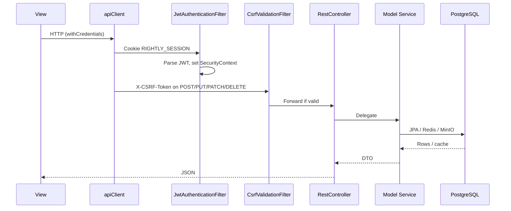
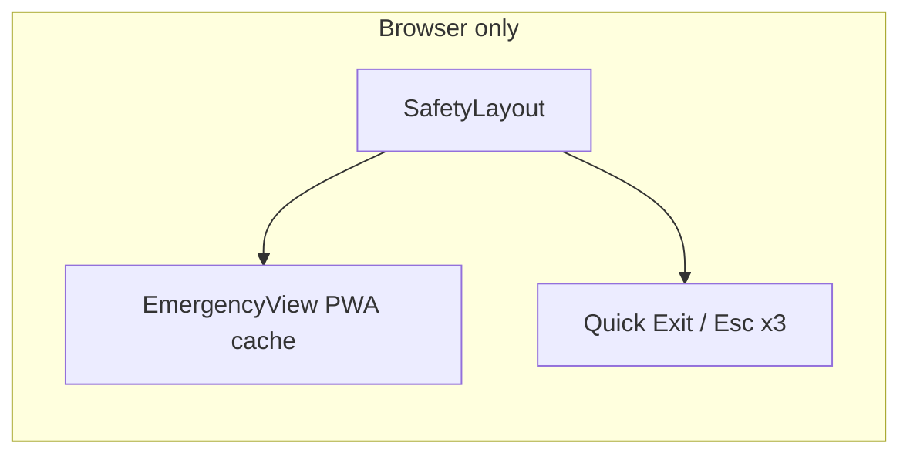
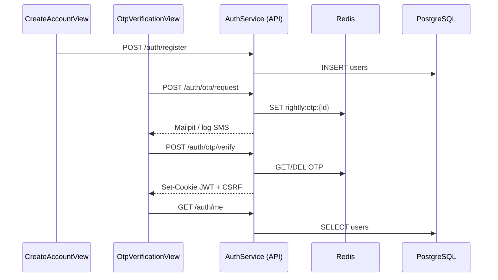
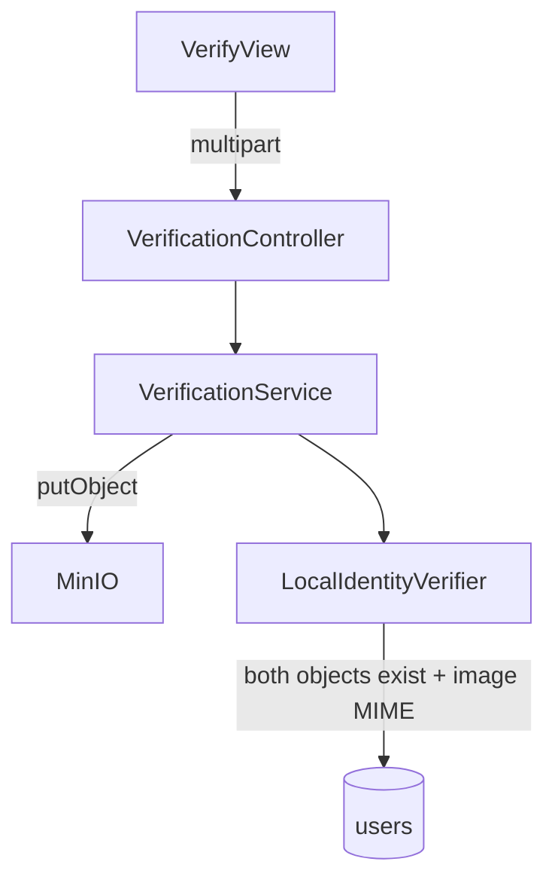
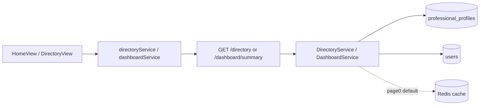

# Rightly — Sprint 1 Data Flow Reference

This document explains **how data moves** for every Sprint 1 capability (SRS §5, Weeks 1–2): from the **React View** through **HTTP APIs** into **Spring MVC Controllers**, **Model services**, and **PostgreSQL / Redis / MinIO**. It covers functional requirements **FR-01, FR-02, FR-10, FR-11, FR-17, FR-19**, plus health checks and the dashboard summary used by the UI.

**Stack roles (MVC):**

| Layer | Location | Responsibility |
|-------|----------|------------------|
| View | `frontend/src/views/`, `layouts/`, `components/` | Render UI, call APIs, browser-only safety (Quick Exit, PWA) |
| Transport | `frontend/src/services/` | Axios + credentials + CSRF header |
| Controller | `backend-java/.../controller/` | Validate DTOs, auth guards, HTTP responses |
| Model | `backend-java/.../model/service|entity|repository/` | Business rules and persistence |
| Data | PostgreSQL, Redis, MinIO, Mailpit | Stores |

**Base URL (local dev):** `http://localhost:8081/api` (`VITE_API_URL` in `frontend/.env`).

---

## Cross-cutting request path

Every authenticated browser call follows the same pipeline:

| Mechanism | Cookie / header | Set by | Used for |
|-----------|-----------------|--------|----------|
| Session | `RIGHTLY_SESSION` (HttpOnly JWT) | `POST /api/auth/otp/verify` | Identity on protected routes |
| CSRF | `RIGHTLY_CSRF` + `X-CSRF-Token` | Same verify response | All mutating requests |
| CORS | `Access-Control-*` | `CorsConfig` | `http://localhost:5173` + credentials |

**Public routes (no JWT):** `/api/health`, Swagger, `POST /api/auth/register`, `POST /api/auth/otp/*`, `GET /api/directory`, `GET /api/dashboard/summary`.

**Protected routes (JWT required):** `/api/auth/me`, `/api/auth/logout`, `/api/verification/*`, `PUT /api/profiles/me`.

---

## Step 1 — Repository contract (no runtime flow)

Documentation and env templates only: `README.md`, `ARCHITECTURE.md`, `.env.example`, Flyway SQL under `backend-java/src/main/resources/db/migration/`. No user-facing data path until Step 2 services and Step 3 API are running.

---

## Step 2 — Data services (infrastructure)

| Service | Port | Consumed by |
|---------|------|-------------|
| PostgreSQL (+ pgvector) | 5432 | JPA, Flyway migrations V1–V4 |
| Redis | 6379 | OTP hashes, directory page-0 cache, future presence |
| MinIO | 9000 | Verification uploads (`verification/{userId}/…`) |
| Mailpit | SMTP 1025 / UI 8025 | OTP email in dev |

Flyway creates schema before the app serves traffic; Spring Boot does **not** write business data until feature endpoints are called.

---

## Step 3 — Health & OpenAPI (foundation)

**FR:** Operational readiness (supports all later features).

| View / client | API | Controller | Service | Data |
|---------------|-----|------------|---------|------|
| DevTools, monitoring | `GET /api/health` | `HealthController` | `HealthService` | `SELECT 1` on Postgres; Redis `PING` |

**Response shape:** `{ "status": "UP"|"DOWN", "postgres": "...", "redis": "..." }`.

Swagger UI: `GET /swagger-ui.html` (permitAll, no DB mutation).

---

## Step 4 — Safety shell (FR-17, FR-19)

Mostly **View-only**; no PostgreSQL reads for the safety chrome itself.

| Requirement | UI entry | Data source |
|-------------|----------|-------------|
| **FR-17** Crisis hotlines | `CrisisBar`, `SiteFooter`, `EmergencyView` | Static `tel:999`, `tel:109`, external mental-health link — not from DB |
| **FR-17** Offline emergency page | `EmergencyView` (`/emergency`) | Vite PWA precache (`vite-plugin-pwa`); static content in View |
| **FR-19** Quick Exit | `CrisisBar`, `useQuickExit` (Esc×3) | `utils/quickExit.ts` → `location.replace` (no API) |

**Layout:** `SafetyLayout` wraps all Sprint 1 routes (`AppRouter`); child routes render in `<Outlet />`.

---

## Step 5 — Authentication (FR-01)

**Requirement:** Users, lawyers, and psychiatrists register with email or phone, receive OTP, log in via cookies.

### 5.1 Registration

| Step | View | Service | API | Controller → Model | Persistence |
|------|------|---------|-----|------------------|-------------|
| 1 | `CreateAccountView` | `authService.register` | `POST /api/auth/register` | `AuthController` → `AuthService.register` | Insert `users` row (`verification_status = UNVERIFIED`) |

**Body:** `{ role, fullName, email? | phone? }` → **Response:** `UserResponse` (no session yet).

### 5.2 Request OTP

| Step | View | Service | API | Model | Stores |
|------|------|---------|-----|-------|--------|
| 1 | `OtpVerificationView` | `authService.requestOtp` | `POST /api/auth/otp/request` | `AuthService.requestOtp` | Redis `rightly:otp:{userId}` (hashed OTP, 5 min TTL); rate limit `rightly:otp-send:{userId}` |
| 2 | — | — | — | `LocalNotificationGateway` | Email → Mailpit; phone → console SMS log |

### 5.3 Verify OTP (login / session)

| Step | View | Service | API | Model | Side effects |
|------|------|---------|-----|-------|--------------|
| 1 | `OtpVerificationView` | `authService.verifyOtp` | `POST /api/auth/otp/verify` | `AuthService.verifyOtp` | Delete OTP key; set `RIGHTLY_SESSION` + `RIGHTLY_CSRF` cookies |
| 2 | `AuthContext` | `authService.me` | `GET /api/auth/me` | `AuthService.me` | Read `users` by JWT `sub` |

### 5.4 Logout

| View | API | Model | Effect |
|------|-----|-------|--------|
| `SiteHeader` | `POST /api/auth/logout` | `AuthService.logout` | Clear auth cookies; subsequent `GET /api/auth/me` → 401 |

### 5.5 Session on page load

`AuthContext` calls `GET /api/auth/me` on mount. **JWT filter** validates cookie; **no fake user** in the View — unauthenticated users see `user = null`.

---

## Step 6 — Identity verification (FR-02)

**Requirement:** Upload NID + selfie; system updates verification status.

| Step | View | Service | API | Controller | Model | Storage |
|------|------|---------|-----|------------|-------|---------|
| 1 | `VerifyView` (multipart) | `verificationService.uploadNid` | `POST /api/verification/nid` | `VerificationController` | `VerificationService.uploadNid` | MinIO `verification/{userId}/nid`; `users.verification_status` → `PENDING` if was `UNVERIFIED` |
| 2 | `VerifyView` (camera/file) | `verificationService.uploadSelfie` | `POST /api/verification/selfie` | same | `LocalIdentityVerifier.verify` | MinIO `verification/{userId}/selfie`; status → `VERIFIED` or `REJECTED` |
| 3 | `DashboardView`, header | `authService.me` | `GET /api/auth/me` | — | Read updated `verification_status` from `users` |

**Auth:** JWT required; CSRF on POST. **No** NID/selfie bytes stored in PostgreSQL — only MinIO keys and status enum on `users`.

---

## Step 7 — Directory & profiles (FR-10, FR-11)

### 7.1 Directory search (FR-10) — public read

| View | Service | API | Controller | Model | Data |
|------|---------|-----|------------|-------|------|
| `HomeView` (counts) | `dashboardService.summary` | `GET /api/dashboard/summary` | `DashboardController` | `DashboardService` | `COUNT` on `professional_profiles` / roles / verified users |
| `DirectoryView` | `directoryService.search` | `GET /api/directory?role&district&specialty&maxFee&language&page&size` | `DirectoryController` | `DirectoryService.search` | JPQL join `professional_profiles` + `users`; optional Redis cache key `rightly:directory:default` (unfiltered page 0, 60s) |

**Startup seed (not UI):** `ProfessionalSeedRunner` inserts 3 demo professionals into `users` + `professional_profiles` when count &lt; 3 — this is the **only** source of directory rows until lawyers/psychiatrists call profile edit.

**UI rule:** Lists and counts come **only** from these APIs — no hardcoded rosters in the View.

### 7.2 Professional profile edit (FR-11) — authenticated

| View | Service | API | Controller | Model | Data |
|------|---------|-----|------------|-------|------|
| `ProfileEditView` | `profileService.updateMe` | `PUT /api/profiles/me` | `ProfileController` | `ProfileService.updateMyProfile` | Upsert `professional_profiles` for current user; role must be `LAWYER` or `PSYCHIATRIST` |

**Body:** `displayName`, `district`, `specialty`, `feeBdt`, `languages`, `bio`.

---

## Step 7 — Dashboard (session + platform stats)

| View | APIs | Data shown |
|------|------|------------|
| `DashboardView` | `GET /api/auth/me` + `GET /api/dashboard/summary` | User name, role, `verificationStatus`, `createdAt`; live counts: `totalProfessionals`, `lawyersCount`, `psychiatristsCount` |

Sprint 2+ placeholders (`/assistant`, `/community`, etc.) **do not** call APIs — `PlaceholderView` only.

---

## Sprint 1 database tables (write paths)

| Table | Written by (Sprint 1) | Read by |
|-------|------------------------|---------|
| `users` | Register, verification status updates | Auth me, directory join, dashboard counts |
| `professional_profiles` | Seed runner, `PUT /api/profiles/me` | Directory search, dashboard counts |
| Flyway V2–V4 tables | Schema only in Sprint 1 | Not used by Sprint 1 UI yet |

---

## Sprint 1 feature → file map (quick lookup)

| Feature | Primary View | Frontend service | Backend controller | Backend service |
|---------|--------------|------------------|--------------------|-----------------|
| Register / OTP | `CreateAccountView`, `OtpVerificationView` | `authService` | `AuthController` | `AuthService`, `NotificationGateway` |
| Session / me | `AuthContext`, `DashboardView`, `SiteHeader` | `authService` | `AuthController` | `AuthService` |
| Verify NID/selfie | `VerifyView` | `verificationService` | `VerificationController` | `VerificationService`, `IdentityVerifier` |
| Directory | `DirectoryView` | `directoryService` | `DirectoryController` | `DirectoryService` |
| Profile edit | `ProfileEditView` | `profileService` | `ProfileController` | `ProfileService` |
| Home / dashboard stats | `HomeView`, `DashboardView` | `dashboardService` | `DashboardController` | `DashboardService` |
| Health | — | — | `HealthController` | `HealthService` |
| Safety UI | `SafetyLayout`, `EmergencyView` | — | — | — |

---

## Local verification checklist

1. `GET /api/health` → postgres + redis UP.  
2. `GET /api/dashboard/summary` → non-zero counts after seed.  
3. Register → OTP in Mailpit → verify → `GET /api/auth/me`.  
4. Upload NID + selfie → `verification_status` on `/api/auth/me`.  
5. `GET /api/directory?district=Dhaka` → filtered rows from PostgreSQL.

See [README.md](../README.md) for startup commands (Docker Compose or Homebrew Postgres + Redis).