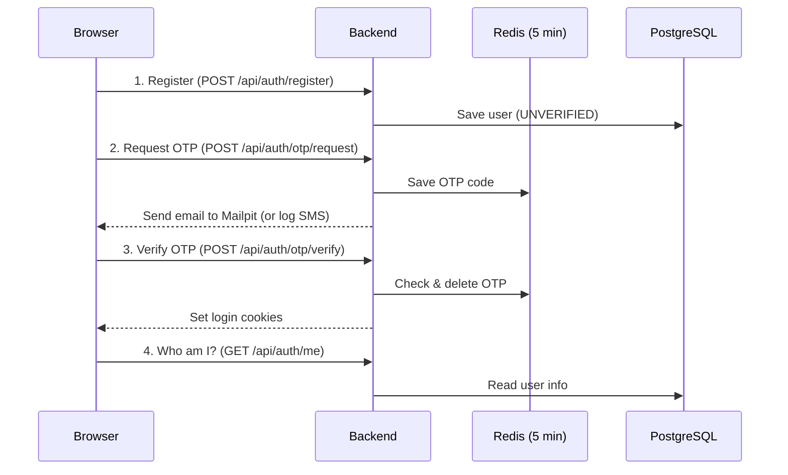

# Rightly — Sprint 1 Data Flow (Simple Guide)

This guide explains how information moves through **Rightly** for every Sprint 1 feature, using simple language.

---

## 1. The Main Parts of the System

Think of Rightly like a restaurant:

| Part | Where it lives | What it does |
|------|----------------|--------------|
| **Frontend (React)** | Your browser (`http://localhost:5173`) | The screen you see and click on. |
| **Backend (Spring Boot)** | `http://localhost:8081/api` | The kitchen. It checks rules, talks to the databases, and sends answers back. |
| **PostgreSQL** | Database (port `5432`) | The permanent filing cabinet. Stores user accounts and professional profiles. |
| **Redis** | Temporary memory (port `6379`) | Sticky notes that expire quickly (holds 5-minute OTP codes and fast page caches). |
| **MinIO** | File storage (port `9000`) | A locker for uploaded photos (NID and selfie images). |
| **Mailpit** | Fake email inbox (port `8025`) | Catches OTP emails on your computer during local testing. |

---

## 2. How Every Request Works

Whenever a page needs or saves data:

1. Your **browser** (`apiClient.ts`) sends an HTTP request to the **Backend** (`http://localhost:8081/api/...`).
2. If you are logged in, your browser automatically sends two cookies:
   - **`RIGHTLY_SESSION`** — your login badge (JWT).
   - **`RIGHTLY_CSRF`** (plus an `X-CSRF-Token` header) — a safety check so other websites cannot fake your clicks.
3. The **Backend** checks your cookies, reads or saves data in **PostgreSQL / Redis / MinIO**, and replies with JSON.
4. Your **browser** updates the screen.

```
Browser (React)  ──HTTP + Cookies──▶  Backend (Spring Boot)  ──▶  PostgreSQL / Redis / MinIO
Browser (React)  ◀───── JSON ───────  Backend (Spring Boot)  ◀──  PostgreSQL / Redis / MinIO
```

- **Public pages (no login needed):** Health check, Register, Request/Verify OTP, Directory search, Dashboard summary numbers.
- **Protected pages (login required):** Who am I (`/api/auth/me`), Logout, NID/Selfie upload, Edit profile.

---

## 3. Feature-by-Feature Data Flow

### A. Safety Bar, Quick Exit & Emergency Page (FR-17, FR-19)

**No backend or database is used here.** Everything happens inside your browser.

- **Emergency numbers (`999`, `109`):** Shown in the top crisis bar, footer, and `/emergency` page as static links.
- **Quick Exit:** Clicking **Quick Exit** (or pressing `Esc` 3 times quickly) immediately replaces the current browser page with a safe external website.
- **Offline Emergency page (`/emergency`):** Saved in your browser's offline cache (PWA) when the app is built, so it still opens without internet.

---

### B. Sign Up & Login with OTP (FR-01)

1. **Create Account (`/register`)**
   - You enter your name, role (`USER`, `LAWYER`, or `PSYCHIATRIST`), and email or phone.
   - Browser calls `POST /api/auth/register`.
   - Backend saves a new row in **PostgreSQL** (`users` table) with status `UNVERIFIED`.
2. **Ask for OTP (`/otp` or `/login`)**
   - You enter your email or phone.
   - Browser calls `POST /api/auth/otp/request`.
   - Backend generates a 6-digit code, saves a hashed copy in **Redis** for 5 minutes (`rightly:otp:{userId}`), and sends it to **Mailpit** (for email) or prints it in the backend terminal (for phone).
3. **Verify OTP (Login)**
   - You enter the 6-digit code.
   - Browser calls `POST /api/auth/otp/verify`.
   - Backend checks **Redis**. If it matches, it deletes the OTP from Redis and sends back the **`RIGHTLY_SESSION`** and **`RIGHTLY_CSRF`** cookies. You are now logged in.
4. **Stay Logged In & Logout**
   - Whenever you refresh the page, `AuthContext` calls `GET /api/auth/me` to ask the backend who is logged in.
   - Clicking **Logout** calls `POST /api/auth/logout`, which clears your cookies.



---

### C. NID & Selfie Verification (FR-02)

1. **Upload NID (`/verify`)**
   - You select an NID photo and upload it (`POST /api/verification/nid`).
   - Backend stores the image file in **MinIO** (`verification/{userId}/nid`) — not in PostgreSQL.
   - Backend updates your status in **PostgreSQL** (`users.verification_status`) to `PENDING`.
2. **Upload Selfie (`/verify`)**
   - You upload a selfie (`POST /api/verification/selfie`).
   - Backend stores the selfie in **MinIO** (`verification/{userId}/selfie`).
   - `LocalIdentityVerifier` checks that both files exist in MinIO and that the selfie is an image.
   - Backend updates your status in **PostgreSQL** to `VERIFIED` (or `REJECTED`).

---

### D. Find a Lawyer or Psychiatrist (FR-10)

1. You open the **Home** page or **Directory** (`/directory`) and optionally pick filters (role, district, specialty, language, max fee).
2. Browser calls `GET /api/directory?...`.
3. Backend searches **PostgreSQL** (`professional_profiles` joined with `users`) and returns matching professionals.
   - **Starter data:** When the backend starts up for the first time, `ProfessionalSeedRunner` adds 3 sample professionals automatically if the database has fewer than 3.
   - **Fast cache:** The default first page (no filters) is cached in **Redis** for 60 seconds.

---

### E. Edit Professional Profile (FR-11)

1. A logged-in **Lawyer** or **Psychiatrist** opens `/profile/edit`.
2. They fill in display name, district, specialty, fee (BDT), languages, and bio.
3. Browser calls `PUT /api/profiles/me`.
4. Backend checks that the user's role is `LAWYER` or `PSYCHIATRIST`, then creates or updates their row in **PostgreSQL** (`professional_profiles` table).

---

### F. Dashboard & Health Check

- **Dashboard (`/dashboard`):** Calls two endpoints and shows real numbers:
  - `GET /api/auth/me` — your name, role, and verification status.
  - `GET /api/dashboard/summary` — total professionals, lawyers, and psychiatrists counted directly from **PostgreSQL**.
- **Health Check (`GET /api/health`):** Runs a quick ping on **PostgreSQL** (`SELECT 1`) and **Redis** (`PING`) to confirm both are running.

---

## 4. Quick Map: Feature → Code Files

| Feature | Frontend Page | Frontend Service | Backend Controller | Backend Service |
|---------|---------------|------------------|--------------------|-----------------|
| Sign up & OTP | `CreateAccountView`, `OtpVerificationView` | `authService.ts` | `AuthController` | `AuthService` |
| Verify NID / Selfie | `VerifyView` | `verificationService.ts` | `VerificationController` | `VerificationService` |
| Directory search | `DirectoryView` | `directoryService.ts` | `DirectoryController` | `DirectoryService` |
| Edit profile | `ProfileEditView` | `profileService.ts` | `ProfileController` | `ProfileService` |
| Home & Dashboard counts | `HomeView`, `DashboardView` | `dashboardService.ts` | `DashboardController` | `DashboardService` |
| Safety bar & Emergency | `SafetyLayout`, `EmergencyView` | — | — | — |
